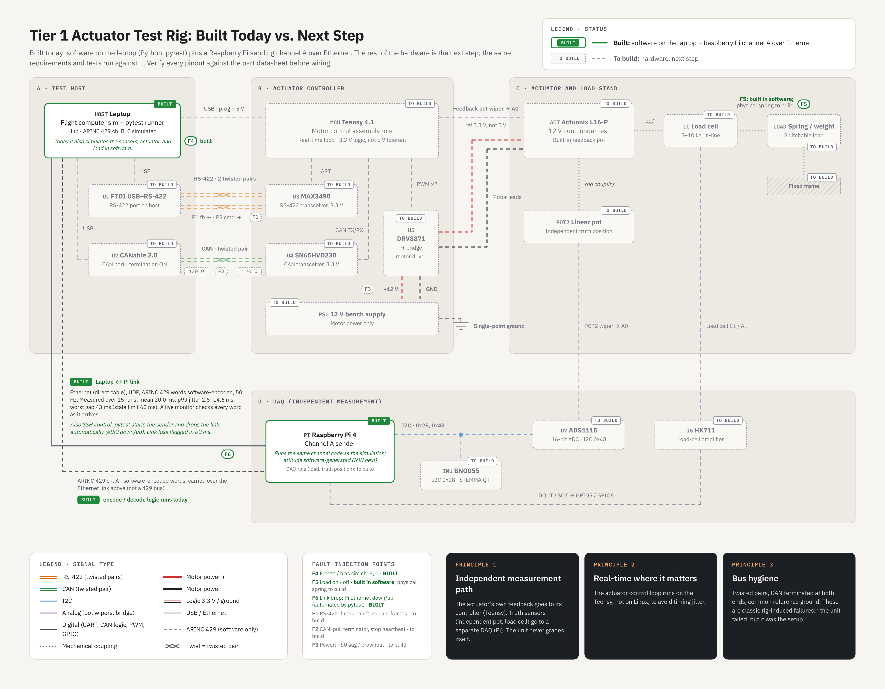
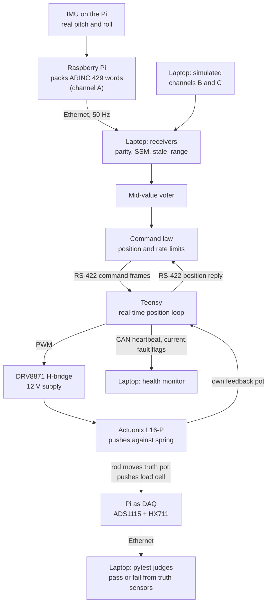
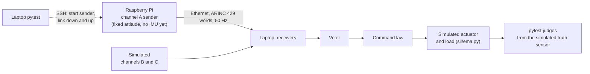

# Tier 1 rig: what's built, what's next, and how it fits together

A plain-language guide to the Tier 1 desk rig diagram ([full-resolution image](figures/tier1_rig_built_vs_next.png)). Tier 1 is a desk-scale actuator test rig: small, cheap parts that play the same roles as a real lab rig. Pin-level wiring is in the diagram; verify every pinout against the part datasheet before wiring anything.

## Built today vs to build

| Block | Part | Role | Status |
| --- | --- | --- | --- |
| **A. Test host** | Laptop | Flight computer sim and pytest test runner; the hub. Today it also simulates sensor channels B and C, the actuator and the load | **Built** |
| A | FTDI USB to RS-422 cable | Command link to the actuator controller | To build |
| A | CANable 2.0 | CAN health bus to the actuator controller | To build |
| **B. Actuator controller** | Teensy 4.1 | Plays the motor control assembly: runs the real-time position loop | To build |
| B | MAX3490 | RS-422 transceiver (3.3 V) | To build |
| B | SN65HVD230 | CAN transceiver (3.3 V) | To build |
| B | DRV8871 | H-bridge that drives the motor | To build |
| B | 12 V bench supply | Motor power only | To build |
| **C. Actuator and load stand** | Actuonix L16-P (12 V) | The unit under test, with its own feedback pot | To build (model already in the repo, M1) |
| C | Linear pot on the rod | Independent truth position sensor | To build |
| C | Load cell (5-10 kg) and spring | Measures and applies the opposing load | To build |
| **D. DAQ (independent measurement)** | Raspberry Pi 4 | Today: sends sensor channel A over Ethernet. Next: also reads the truth sensors and the IMU | **Built** (channel A), DAQ role to build |
| D | ADS1115 ADC | Reads the truth pot for the Pi | To build |
| D | HX711 | Load-cell amplifier for the Pi | To build |
| D | BNO055 IMU | Real attitude sensor, so channel A is real data | To build |
| Link | Laptop to Pi Ethernet cable | ARINC 429 words (software-encoded) over UDP, plus SSH control and the automated link drop | **Built** |

**In one line:** the software is built and runs today, the Pi link is built and tested on real hardware (15 live runs, [bench_runs/](../bench_runs/README.md)), and all the actuator hardware is the next step. The same requirements and tests run at every step; only the fixture behind them changes.

## How it works, beginning to end (full Tier 1 rig)

Step by step:

1. **Sense.** The IMU on the Pi measures pitch and roll. The Pi packs them into ARINC 429 words (label, data, SSM, parity) and sends them every 20 ms over Ethernet as channel A. Channels B and C are simulated on the laptop, so faults can be injected into them.
2. **Check every word.** The laptop's receivers check each word: parity, sensor status (SSM), freshness (stale after 3 missed words, 60 ms), and physical range.
3. **Vote.** The mid-value voter takes the middle of the three channels, drops a channel that disagrees too long, and runs on two if it has to.
4. **Command.** The command law turns the voted pitch into an actuator position, inside position and rate limits.
5. **Drive.** The command goes over RS-422 to the Teensy. The Teensy runs the fast position loop (real-time, not on Linux), drives the motor through the H-bridge, and reads the actuator's own feedback pot.
6. **Report health.** The Teensy replies with its measured position on RS-422 and broadcasts a heartbeat, motor current and fault flags on CAN.
7. **Measure independently.** A separate truth pot on the rod and the load cell are read by the Pi as the DAQ, on a path the actuator controller never touches.
8. **Judge.** pytest compares the truth measurements to the requirements and writes the traceability matrix. **The unit never grades itself.**

## How it works today (built)

Steps 1-4 run with one real hardware piece (the Pi on channel A). Steps 5-7 are simulated in software today, with the same interfaces the hardware will use.

## Fault injection points

| Point | What it does | Status |
| --- | --- | --- |
| F1 | RS-422: break a pair, corrupt frames | To build |
| F2 | CAN: pull a terminator, stop the heartbeat | To build |
| F3 | Power: 12 V sag or brownout | To build |
| F4 | Freeze or bias simulated channels B and C | **Built** (the fault matrix) |
| F5 | Load on or off | **Built in software** (every system test runs unloaded and at rated load); physical spring to build |
| F6 | Link drop: Pi Ethernet down and up, automated by pytest | **Built** (the bench cable pull) |

## The three design principles

1. **Independent measurement path.** The actuator's own feedback goes to its controller. The truth sensors go to a separate DAQ. The unit never grades itself.
2. **Real-time where it matters.** The actuator loop runs on the Teensy, not on Linux or Windows. The bench jitter finding (below) is a live example of why.
3. **Bus hygiene.** Twisted pairs, CAN terminated at both ends, one reference ground. Classic rig-caused failures: "the unit failed, but it was the setup."

## Pi link timing (measured)

The diagram's Pi link note shows the measured timing over 15 live runs: words arrive every 20.0 ms on average, p99 jitter is 2.5-14.6 ms, and the worst gap is 43 ms, still under the 60 ms stale limit. A live monitor checks every word as it arrives.

Jitter was 2.5 ms in Test Set 1 (2026-10-16) and 6.3-14.6 ms in Test Set 2 (2026-10-18). An A/B test (Test Set 3, live monitor off) showed the rise is mostly the bench setup, with a smaller effect from the live monitor. Test Set 4, the run for record on 2026-10-19, measured 9.5 ms. It's an open finding; every run's report is in [bench_runs/](../bench_runs/README.md), and see the README results and [docs/procedures/bench-link.md](procedures/bench-link.md).

## Related

- How tests run at each level: [docs/TEST-FLOW.md](TEST-FLOW.md)
- The Pi bench, step by step: [docs/BENCH-GUIDE.md](BENCH-GUIDE.md)
- Predicted results for the L16-P bench actuator: [reports/l16p_predictions.md](../reports/l16p_predictions.md)
