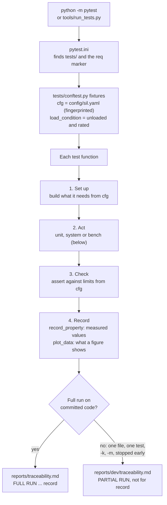
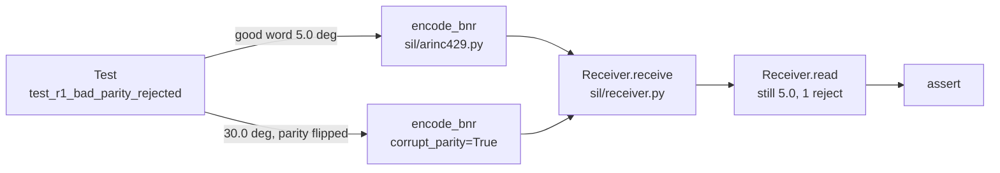
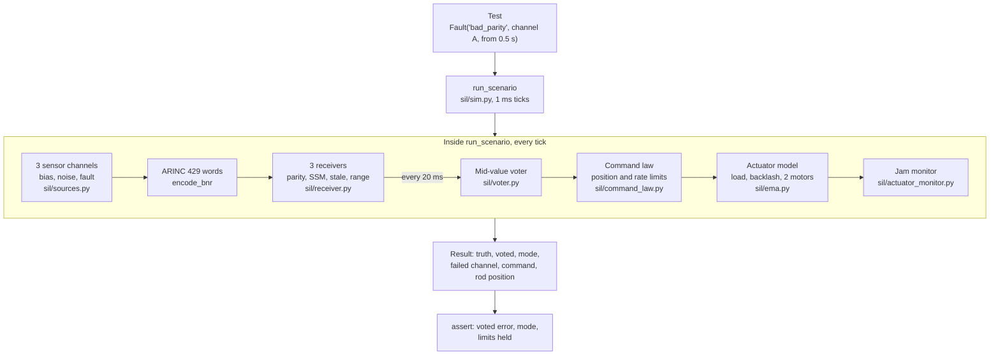
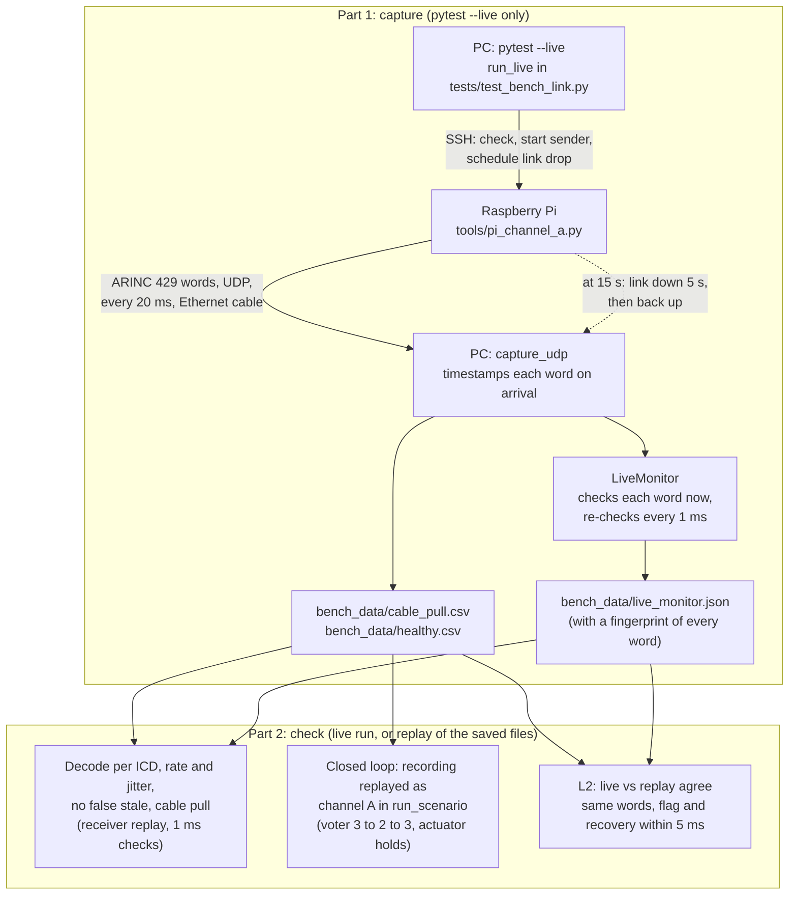

# Test flow: unit, system and bench tests

How a test run goes from `pytest` to the traceability matrix, for each of the three test levels. Every test follows the same four steps: **set up, act, check, record**. What changes from level to level is how much of the system runs in "act".

| Level | What runs in "act" | Where the words come from | Example |
| --- | --- | --- | --- |
| **Unit** | One component alone (encoder, receiver, voter, actuator model, command law) | The test makes them by hand | [TC-R1-U01](procedures/part-b-receiver.md#tc-r1-u01-receiver-rejects-a-word-with-bad-parity) |
| **System** | The whole loop: sensors, receiver, voter, command law, actuator, monitor | Simulated sensors | [TC-FM-S01](procedures/part-b-system.md) |
| **Bench** | The same receiver, voter and actuator code, fed by real hardware | A Raspberry Pi over a real Ethernet cable | [TC-L1-B03](procedures/bench-link.md) |

## 1. The common flow (every test)

The report hook (end of `tests/conftest.py`) groups results by requirement, gives each a verdict (PASS, FAIL, OPEN DEFECT, NOT RUN, NOT TESTED) and shows each requirement's tests by name and level, stamped with the git commit and the config fingerprint. It also writes the plot data the tests saved to `reports/data/`, each file stamped with its test, that test's result, the commit and the config. `tools/make_figures.py` then draws the figures only from those files, so every point on a plot traces to the run for record ([EVIDENCE.md](EVIDENCE.md)).

## 2. Unit test

One component, driven step by step by the test. Example: R1, a word with bad parity is rejected.

Only two files run. Timing is exact and made up by the test. It proves the logic is right.

## 3. System test

The whole loop runs inside one call, `run_scenario()` in `sil/sim.py`, ticking every millisecond. The test describes a fault, runs the loop, then checks the results. Example: the fault matrix (9 faults x 3 channels).

Timing is exact but simulated. It proves the whole system stays safe when a part fails.

## 4. Bench test (Raspberry Pi)

Two parts: **capture** (needs the Pi, live mode only) and **check** (needs only the recording, so it runs anywhere). With `--live`, a live monitor also checks every word while it arrives.

Timing is real, with network jitter. It proves the logic still works with messy real timing and a real link loss.

**Why capture and check are separate:** one capture feeds all seven bench tests; anyone (GitHub CI, any laptop) can re-check real Pi data without the Pi; and the recording, with its header, is kept as evidence. A replay alone re-checks old data; the run for record starts with a fresh live run.

**The three levels on one requirement (R3, stale detection):** the unit test checks the logic with perfect timing, the system fault matrix checks the whole loop rides through a dropout, and the bench cable pull checks it on a real link. Each level catches something the one below can't.

## Where to go next

- Test procedures for every test, step by step with the Python line each step runs: [docs/procedures/](procedures/README.md)
- The hardware this grows into: [docs/RIG-OVERVIEW.md](RIG-OVERVIEW.md)
- Running it yourself: [docs/USER-GUIDE.md](USER-GUIDE.md); the Pi: [docs/BENCH-GUIDE.md](BENCH-GUIDE.md)
